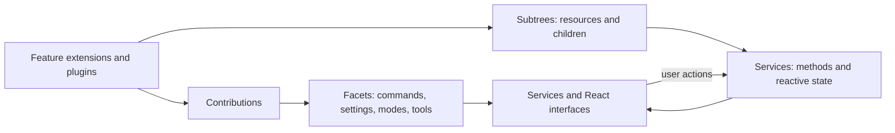
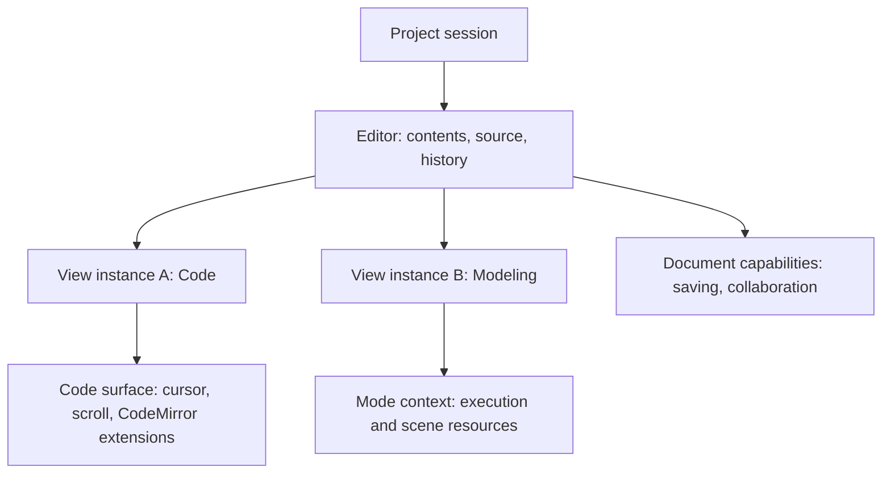
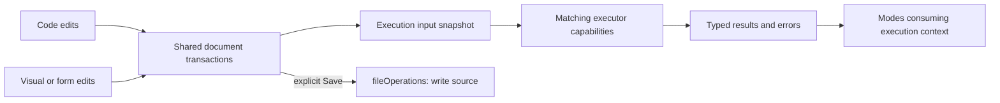

# Application architecture

Zoo Design Studio composes services and contributed behavior into a reactive application, with React rendering its interfaces. The web application also runs inside Electron for desktop filesystem access and other native interactions. The goal is to let the same building blocks support a full modeling workspace, a viewer, or a code editor without each interface having to assemble its own application runtime.

This document describes the architecture being developed across several stacks, rather than everything available on `main` today:

- [Plankton and the application migration (#15039)](https://github.com/KittyCAD/modeling-app/pull/15039) supply the composition and resource-lifetime primitives used below.
- [Editor documents and modes (#15031)](https://github.com/KittyCAD/modeling-app/pull/15031) and [their project-shell integration (#15032)](https://github.com/KittyCAD/modeling-app/pull/15032) separate a document from its presentations.
- Execution, saving, modeling tools, and editor dialogs build on those editor contracts in downstream branches. They illustrate how the pieces fit together; they are not all part of those PRs.

The editor stack still uses the earlier registry API, including identifiers ending in `ValueSpec`. Its integration with Plankton remains work to do. The new project shell and editor contributions are gated by `zds_project_shell_refactor`. Plankton names in this document describe the target composition API; they do not imply that the stacks have already been merged together.

## Principles

- **Keep user-authored source authoritative.** KCL expresses models; Markdown, DOT, TOML, and other formats express their own documents. A visual edit should produce a document transaction that other views can observe and undo. Execution results are derived from a particular source snapshot.
- **Separate a working document from storage.** A buffer can be unnamed or contain unsaved changes. Reading and writing files are explicit operations, not prerequisites for every edit or execution.
- **Make ownership explicit.** A project session owns its working documents. Views, document behavior, and engine connections each need a defined owner and cleanup point. Hiding a React component need not end the resource's lifetime.
- **Extend through contracts.** Subsystems publish services and contribution points. Other extensions add commands, modes, settings, tools, and interfaces through those contracts instead of reaching into an unrelated singleton.
- **Compose features as well as interfaces.** A format extension can provide its language support, execution behavior, and visual mode together. The host supplies the project, document, and layout machinery.

User and project settings remain TOML-based configuration. They are distinct from document contents, execution results, and extension-owned metadata such as collaboration history. A project session must also be useful for projects without a KCL file; its editor model does not require every document to be a saved file.

## Application composition with Plankton

Plankton is the composition package. A `Registry` installs a graph of items, exposes live observations of their contributions, and owns acquired resources. Its Facets are inspired by [CodeMirror's facets](https://marijnhaverbeke.nl/blog/facets.html); application reactivity uses Preact Signals.

| Term | Role |
| --- | --- |
| **Facet** | Combines an ordered list of contributed inputs into an output. Its pure combiner also defines the output when there are no inputs. |
| **Service** | A singleton capability exposed through a specialized Facet. There may be no provider, one provider, or a conflict; provider order does not resolve a conflict. |
| **Contract** | A named collection of Facet and Service tokens that consumers and contributors share. |
| **Binding** | A typed registration that contributes a source callback to a Facet, with optional ordering and key information. |
| **Subtree** | An owner with declared dependencies, synchronous acquisition, replaceable children, and cleanup that may be asynchronous. |
| **Item** | A Binding, a group of Items, or a Subtree. Static groups are ordinary arrays; they do not need an extra resource owner. |
| **Signal** | A live value that records reactive dependencies when read. `observe` exposes a Facet's live output; `get` reads its current output. |
| **Extension** | An application feature assembled from these items, such as Markdown support. This describes a role, not another Plankton primitive. |
| **Plugin** | A toggleable group built from a Subtree. Its metadata and controller remain installed while its feature contents are disabled. |

“Capability” describes an ability supplied to the application, such as reading files or executing KCL. It is not a synonym for every node in the graph. In particular, an **editor capability** is a specific document-behavior contribution described below.



For example, this small composition installs one panel contribution, then replaces it without replacing its owner:

```ts
import { Facet, Registry, contribute, slot } from 'plankton'

const panels = new Facet('panels', (values: readonly string[]) => values)
const sidebar = slot([contribute(panels, () => 'outline')], 'sidebar')
const registry = new Registry()

await registry.configure([sidebar])
await registry.replace(sidebar, [contribute(panels, () => 'search')])
registry.get(panels) // ['search']
await registry.dispose()
```

A contribution's source is explicitly a callback. It can return a constant or read signals; a reactive source changing does not require rebuilding the whole graph. Replacing a Subtree's children is a different operation, used when installed behavior changes. The old registry's ValueSpecs and Compartments are replaced by Facets and Subtrees respectively, but the new API also makes sources and ownership explicit.

Dependencies are planned before acquisition. A factory can obtain a service observation during construction, but must defer reading it until construction finishes. This lets the graph be assembled before consumers evaluate it, instead of recursively constructing services from inside a Facet computation.

Application graph changes are serialized and awaited. In the migration, `App.registryReady` waits for queued updates, including nested changes. Removing an owner releases its children before the owner and its consumers before their dependencies; shutdown awaits finalizers. A failed acquisition leaves the previously published graph usable. Cleanup failure after a successful publication is reported without pretending that publication was rolled back.

The [Plankton package guide](https://github.com/KittyCAD/modeling-app/blob/codex/plankton-migration/packages/plankton/README.md) specifies identity, precedence, service resolution, and failure behavior in detail.

## Documents, presentations, and modes

An **Editor** is one live working document: identity, optional source location (`src`), contents, classification, transactions, and undo history. It is not the React component or the native CodeMirror view displaying that text.

An **EditorViewInstance** presents an Editor. Each instance chooses a **mode**, a contributed interface for that document. Code is the universal base mode. Markdown preview, Modeling, and Drawings are examples of other modes, which can receive typed context from a provider. Execution-backed interfaces use this same mode contract, with execution providing their additional context.



Two tabs can therefore edit the same document in different modes. Their text and undo history are shared, while their Code cursors, scroll positions, and mode choices are independent. Cross-view geometry highlighting and command argument selection can consume explicit selection events and execution mappings; sharing a document does not automatically synchronize every cursor.

The Open editor command reuses an already-open document for that source and creates another presentation. The lower-level API can still create independent documents with the same source when a caller deliberately needs them. New editor creates an unnamed buffer with a Code presentation; assigning a source later preserves the buffer and history.

Classification describes a language ID and an optional media type. Language contributions infer it from source and contents before matching CodeMirror extensions, avoiding a cycle in which installed syntax determines which syntax to install. An explicit language choice can classify an unnamed buffer. A filename extension is a useful matching shorthand, not itself a language or MIME type; unknown media types remain unknown.

Contributions can match a file extension, `*`, or a predicate over source, contents, language ID, and media type. Changes to those inputs or registered contributions reevaluate matching. A mode's priority determines the default among matches; an explicit matching choice takes precedence. This lets Modeling be the default for KCL while Code remains available. Availability should describe which documents a mode supports: a Drawings mode can handle a KCL document with no sheets through its own empty state.

### Contribution ownership

| Contribution | What it supplies | Lifetime |
| --- | --- | --- |
| Language descriptor | Inferred language and optional media type | Registered classification rule; no mounted Code surface required. |
| Editor capability | Document behavior through `setup({ editor, onDispose })` | Once per matching Editor. Saving and collaboration belong here. |
| Code extension | Native CodeMirror syntax, keymaps, decorations, or selection listeners | Per matching Code surface. Its factory receives the document, view instance, native view, and cleanup registration. |
| Mode | A component and optional typed context provider | Context belongs to a view/mode pair and survives mode switches and React remounts. It ends when that view closes, the contribution is withdrawn, or it stops matching. |
| Tab indicator | A component observing document status | Rendered beside each view's document name; views of one document observe the same dirty state, for example. |

The separate document and Code-surface contracts establish ownership that CodeMirror's broad `Extension` type does not express. A save shortcut can be installed on every Code surface while the save service and dirty baseline belong to the shared document.

Closing one view releases that view's resources. Closing the last view releases its document and associated behavior, including executors bound to it. Closing the project releases all remaining documents and views. Merely hiding or remounting the pane does none of those things.

## Execution and persistence

An **executor** binds explicitly to an Editor and watches its source, contents, and matching executor capabilities. It is independent of which editor has focus. An **executor capability** runs against the captured contents and receives the bound editor context; it returns typed data or an error. The executor runs matching capabilities and coalesces their outputs, retaining each capability's result type for consumers.



Edits trigger execution without waiting for Save. New input interrupts superseded work through Effect-managed execution scopes; one capability's expected failure becomes a collected result rather than hiding its siblings. Interruption cannot undo commands already sent to an external engine, so engine adapters still need to sequence operations and forward cancellation where supported.

A mode can acquire a shared executor lease for its document, or own a separate executor when its resources require that. This is an ownership choice, not a consequence of editor focus or a requirement that every document have exactly one executor. KCL scene resources include an engine session and stream element; a DOM element cannot be mounted into two presentations at once.

Saving passes the document's source and a captured buffer snapshot through `fileOperations`, then records the successful checkpoint. Edits made during a pending write must remain dirty. All views of the document see the same checkpoint; another view's execution already reacts to the shared edits. Plain-text saving and preserving CRDT history are separate persistence responsibilities.

Project loading and Open perform asynchronous reads before synchronous document creation. The project session supplies project identity and file discovery; `fileOperations` supplies reads and writes. Execution adapters that need imports assemble a project source snapshot, with open buffers taking precedence over disk contents, rather than submitting only the active file or reading through an unrelated editor singleton.

## Building domain workflows

A format extension can contribute several complementary pieces through the same application contracts:

| Extension | Editing | Execution and modes |
| --- | --- | --- |
| Markdown | Language classification and Code syntax | Parse the buffer and show a Markdown preview mode. |
| KCL | Language classification and Code syntax | Execute a project snapshot, expose engine results, and show Modeling. |
| Drawings | KCL's existing editing support | Consume drawing data and present sheets in a Drawings mode. |
| DOT | Graph-language editing support | Present a graph mode whose drag operations write node positions back to the document. |

Commands own user actions. A modeling tool contribution can describe a command's toolbar placement and availability, while the command uses the existing stdlib argument definitions, evaluator, and codemod. The final edit should apply precise document changes in one transaction so selections and history survive; the toolbar should not contain a second implementation of Extrude.

Editor dialogs apply the same model to a temporary document rather than a project tab. A compact host provides Submit and Cancel; Code and a domain-specific Form edit the same draft. A semantic document descriptor identifies a command draft independently of its language, while a schema describes its arguments and typed context carries runtime resources. Submission consumes a current successful result and applies the prepared edit to the target document. Cancel disposes the draft. This is a downstream extension of the editor model, not a prerequisite for ordinary project editors.

First-party features use the same document, command, execution, mode, and layout contracts that third-party extensions would consume. An extension adds its interface together with its behavior; the host owns the project and supplies the resource lifetimes.
