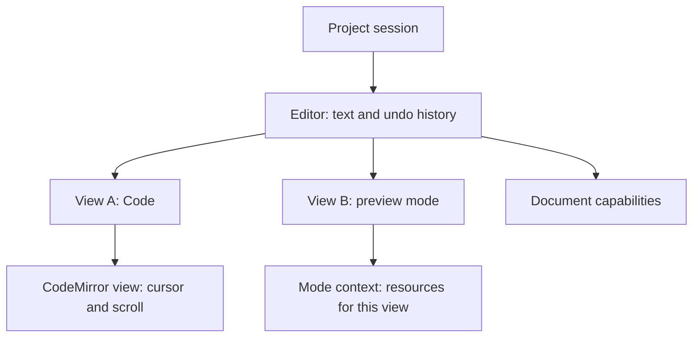
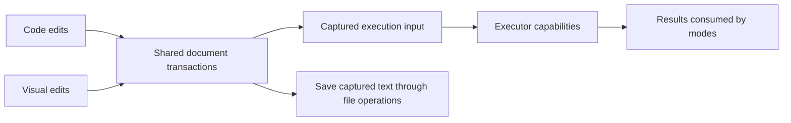

# Application architecture

Zoo Design Studio assembles features with [Plankton](../../packages/plankton/README.md). Features contribute commands, settings, editor modes, and other behavior through shared contracts. React renders those contributions; factories own the resources behind them. The browser and Electron shells use the same composition system, with different implementations for capabilities such as file access.

## The composition algebra

Plankton builds an application from a small set of types:

| Type | Purpose |
| --- | --- |
| `Facet<Input, Output>` | Combine an ordered collection of contributions into one value. The combiner must also handle an empty collection. |
| `Binding` | Contribute a value to a Facet through a source function. |
| `Factory<Exports>` | Create an instance with declared dependencies, exported values, and optional startup and cleanup. |
| `Signal<T>` | Observe a changing value. Reading `.value` in a reactive computation tracks that dependency. |

These combine as:

```ts
type Extension = Binding | Factory | readonly Extension[]
```

An array groups Extensions without creating another resource owner. A `Registry` installs them, exposes Facet outputs, and manages Factory instances. An application feature can export one Binding, an array, or a Factory according to what it needs.

### Contribute a value

A Facet defines how contributions combine. This example collects panel names:

```ts
import { signal } from '@preact/signals-core'
import { Facet, Registry, contribute } from 'plankton'

const panels = new Facet('panels', (names: readonly string[]) => names)
const title = signal('Outline')
const registry = new Registry()

await registry.configure([
  contribute(panels, () => 'Files'),
  contribute(panels, () => title.value),
])
registry.get(panels) // ['Files', 'Outline']

title.value = 'Search'
registry.get(panels) // ['Files', 'Search']
await registry.dispose()
```

The source callback can return a constant or read Signals. Changing `title` updates the output without reinstalling the contribution. `registry.observe(panels)` supplies a live Signal for consumers; `get` reads its value at that moment. Facet combiners and source callbacks must be pure: they calculate values without starting work or changing application state.

### Extend an application contract

Most features contribute to an existing Facet. For example, this declaration tells the editor system how to classify Markdown files:

```ts
import { contribute } from 'plankton'
import { editorLanguagesFacet } from '@src/lib/editors/registry/contract'

export const markdownLanguage = contribute(editorLanguagesFacet, () => ({
  id: 'markdown',
  matches: '.md',
  mediaType: 'text/markdown',
}))
```

Installing the Binding makes it available to the editor system. The declaration needs no Factory because it creates no instance or cleanup work. The full [Markdown extension](../../src/lib/markdown/registry/index.ts) also contributes syntax support, a computation, and a preview mode.

### Share a constructed dependency

Use a Factory when a feature creates state or resources, needs another Factory's exports, or owns replaceable contributions:

```ts
import { signal } from '@preact/signals-core'
import { factory } from 'plankton'

const documentModel = factory({
  create: () => ({ exports: { title: signal('Untitled') } }),
})

const outline = factory({
  dependencies: { document: documentModel },
  create: ({ document }) => ({
    items: [contribute(panels, () => document.title.value)],
  }),
})
```

This uses the `panels` Facet from the first example. Configuring `outline` creates `documentModel` first and passes its exports as `document`. Other Factories depending on that same Factory receive the same instance within the Registry. Removing one consumer keeps the model alive while another consumer still needs it.

## Consume contributions through contracts

The Markdown example contributes to `editorLanguagesFacet`, which the editor system uses to discover language descriptors from installed features. Both import the same token. A Contract groups these shared tokens under names, giving producers and consumers a common set of contribution points.

The [project libraries guide](../../src/lib/projectLibraries/README.md) shows how a built-in library type and a separate extension use the same contract to supply libraries and their operations to Home.

Facets can collect many contributions, as `panels` does above. A contract can also declare a Service when consumers need one implementation of a capability, such as file access. A Service is a specialized Facet that reports an absent provider, selects one provider, or reports a conflict. `service<T>(name)` declares the token and `provide(token, implementation)` supplies a provider. After configuration, `registry.required(token)` requires one provider; `registry.optional(token)` permits absence. Both report conflicts rather than choosing by registration order.

### Read live inputs after construction

A consumer can follow a contract's contributions as features are installed, removed, or replaced. This differs from the `outline` example, where construction depends on a particular Factory's instance:

- Declare a concrete Factory dependency when construction needs that instance's exports. Those exports are available inside `create`, and can themselves contain changing Signals.
- Observe a Facet or Service when the consumer must follow contributions being added, removed, or replaced. Creating an observation is allowed during `create`; reading its value must wait until the configuration is published.

The Registry makes a complete configuration visible after construction. This is publication. Waiting until then lets an observer read the assembled contributions, including Service providers, rather than an incomplete configuration.

The application's [input helpers](../../src/registry/inputs.ts) declare observations through the same Factory dependency map. Contracts export an `observations` Factory so consumers can name their live inputs. For example, this Factory reports theme changes:

```ts
import { effect } from '@preact/signals-core'
import { factory } from 'plankton'
import { observations } from '@src/registry/contracts/settings'

const reportTheme = factory({
  dependencies: { settings: observations },
  create: ({ settings }) => ({
    start: () => effect(() => {
      // Note: we still have work to do to clean up the settings system!
      const service = settings.settingsService.current.value
      if (!service) return
      console.info(service.current.value.app.theme.currentSignal.value)
    }),
  }),
})
```

`start` runs after publication, when the observation can be read. The effect handles an absent provider because live inputs can disappear. Its returned cleanup stops the effect when the Factory is removed. A lazy `computed` can also be created during construction, provided its first read happens after publication. This keeps graph construction separate from computations that depend on the assembled graph.

## Replacement and resource lifetime

Changing a source Signal changes a contributed value. Changing which Extensions are installed is a separate operation. `configure` replaces the Registry's roots; `replace` changes a mounted Factory's children while retaining its instance and dependencies. A `slot` is a Factory that owns replaceable children without other resources:

```ts
import { slot } from 'plankton'

const sidebar = slot([contribute(panels, () => 'Outline')], 'sidebar')
const shell = new Registry()
await shell.configure([sidebar])
await shell.replace(sidebar, [contribute(panels, () => 'Search')])
await shell.dispose()
```
### Plugins
Plugins build on these primitives. A plugin keeps metadata and enable/disable controls installed while a Slot contains its toggleable features. Disabling it removes those features and releases resources no longer needed elsewhere. The [application plugin helper](../../src/registry/createZdsPlugin.ts) adds ZDS settings and feature controls around Plankton's plugin support.

### Identity
Factories are shared by object identity, or by an explicit `key`. A retained Factory keeps its instance and captured dependencies. Replacing its children does not rerun `create`; changing its constructor dependencies requires removing and reacquiring it. A Binding's optional key instead identifies a contribution within its Facet. Precedence and declaration order determine which duplicate contribution key wins. Service conflicts remain errors.

### Acquisition & publication
The Registry creates dependencies before their consumers and publishes the resulting contributions together. If creation fails, it releases newly returned instances and keeps the previous configuration available. Code that allocates resources and throws before returning an instance must release those resources itself.

### Clean-up
After publication, removed instances finish cleanup before new instances start. Cleanup releases children before their owners and consumers before their dependencies. A Factory's startup cleanup runs before its `dispose` callback. Cleanup can be asynchronous; failures are collected while the remaining cleanup continues. A failure after publication does not restore the previous graph.

### Graph operations are async
Await `configure`, `replace`, and `dispose` before starting another graph mutation. Plankton rejects overlapping mutations; the [application host](../../src/lib/app.ts) queues application updates. React unmounting ends a Factory's lifetime only if its owner removes it from the graph.

See the [package guide](../../packages/plankton/README.md) for the full identity, startup, and failure contracts.

## Working documents and their views

An Editor owns working text and undo history. Its source location is optional, so editing and execution can work before a file is saved. A project session owns its open documents; file operations supply storage access.

An editor view instance presents one Editor in a chosen mode, such as Code, KCL Modeling, or Markdown preview. Several views can share the same document while keeping separate mode choices, Code cursors, and scroll positions. Opening an already-open source creates another presentation of its document. The lower-level editor API can deliberately create independent documents for the same source.



The editor contracts separate contributions by responsibility:

| Contribution | Responsibility and lifetime |
| --- | --- |
| Language descriptor | Infer language and optional media type from source and contents, independently of a mounted view. An explicit language choice can classify an unnamed buffer. |
| Editor capability | Add document behavior, such as saving, once per matching Editor. |
| Code extension | Install CodeMirror behavior separately in each matching Code surface. |
| Mode | Supply a component and optional context owned by a particular view/mode pair. |
| Tab indicator | Show document status beside a view's name. |

Matching can use a filename extension, a wildcard, or a predicate over source, contents, and classification. A mode's priority determines the default; an explicit choice remains selected while it matches. Context setup and cleanup belong to the view/mode pair, so switching modes or remounting React preserves that context. Closing a view releases its contexts; closing the last view releases its Editor. Project shutdown releases the remaining documents and views.

Keep behavior at its owning layer. A component can invoke a command and display its result, while document transactions, storage operations, and resource cleanup remain usable without that component mounted. The [editors guide](../../src/lib/editors/README.md) describes these contracts and lifetimes.

## Execution and saving

An executor runs matching computations against captured document input and publishes typed results and errors. It is bound to an Editor independently of focus. Consumers can lease a shared executor for that document or deliberately create a separate one. Additional inputs, such as imported buffers, can contribute revisions that make a result stale or require another computation.



Execution consumes working contents independently of saving. A project source snapshot can include unsaved imported buffers, with stored files supplying the remaining bytes. Consumers must preserve the relationship between a result and the input that produced it. Cancellation can stop superseded computation, but cannot undo commands already sent to an external engine; native adapters still need their own sequencing and cleanup.

Saving captures the document's source and contents, writes that snapshot, and records the successful checkpoint. Edits made during the write remain dirty. Views of the same Editor share that checkpoint. Save timing, storage access, execution, and persistence of collaboration history are separate responsibilities. See the [executor](../../src/lib/executors/README.md) and [save](../../src/lib/save/README.md) guides for their contracts.

A domain feature can bundle these contributions without becoming their owner. Markdown combines language support, parsing, and preview. A Modeling mode can combine KCL execution with scene controls; a drawing interface can consume derived drawing data. Visual tools should apply document transactions through the editor so other views and undo history observe the edit. Application shortcuts belong to registered commands and scoped keymap contributions, alongside the feature that supplies the action.
