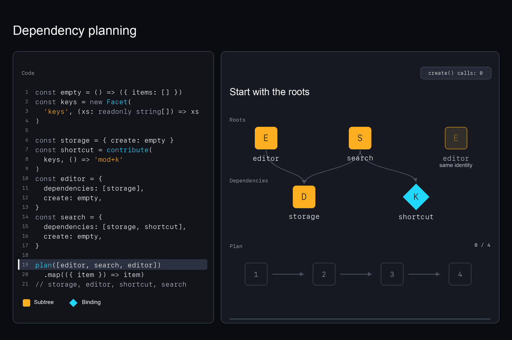

# Plankton

Plankton lets independent features contribute commands, panels, configuration, and
services to one application. A Registry assembles those contributions, manages
resources created by features, and lets parts of the application be replaced at
runtime. The application uses this package throughout its extensions, plugins,
views, and editor integrations.

For design guidance and checks, see [CONTRIBUTING.md](CONTRIBUTING.md).

```ts
import { Registry, Facet, contribute, slot } from 'plankton'

const panels = new Facet('panels', (values: readonly string[]) => values)
const sidebar = slot([contribute(panels, () => 'outline')], 'sidebar')
const registry = new Registry()
await registry.configure([sidebar])
await registry.replace(sidebar, [contribute(panels, () => 'search')])
registry.get(panels) // ['search']
await registry.dispose()
```

## Primitives

| Primitive | Role |
| --- | --- |
| **Signal<T>** | A readonly view of a changing value. Computations and effects that read it can react to updates. |
| **Facet<I, O>** | Combines ordered contributions of `I` into one `O`. Its combiner also defines the result when there are no contributions. |
| **Binding** | Contributes to a Facet through a function that returns a constant or reads changing values. Optional keys and precedence control which contributions are included and in what order. |
| **Factory<T>** | An object with `dependencies` and `create`. Its instance exports `T`, may install child Extensions, and can return startup and cleanup callbacks. |
| **Extension** | The composable union: a Binding, a Factory, or an array of Extensions. Arrays group declarations without creating another instance to manage. |

Each Registry shares a Factory's instance with all Factories that depend on it.
Removing an Extension cleans up Factory instances that are no longer reachable.
A shared dependency remains alive until its last dependent is removed, unless it
is also configured directly.

## Building an application

Pass Extensions to `registry.configure(...)`. The Registry calls each Factory's
`create` after creating its declared dependencies, and passes their exported
objects directly to it. For example, a files Factory can hand its file operations
to an editor Factory during `create`. Creating these instances is called
**acquisition** below.

The Registry finishes creating the instances before making the new contributions
visible together. A reader sees commands and panels from the same configuration,
without a mixture of old and new contributions. This all-at-once switch is
**atomic publication**; the currently visible configuration is the **published
graph**. If creation fails, the Registry cleans up the new instances and keeps
the previous configuration available.

For inputs that should follow later changes, `registry.observe(facet)` returns a
Signal called an **observation**. It updates when contributions change or their
source functions read Signals that change. These observations cannot be read
inside `create`, while the new configuration is still being assembled. Return a
`start` callback to begin work that reads them after publication and cleanup of
removed instances. `start` can return a cleanup function to stop that work when
its instance is removed.

## Constructions built from the primitives

| Construction | How it is composed | What it enables |
| --- | --- | --- |
| **Service<T>** | A specialized Facet that selects zero or one provider and reports conflicting providers. | Share an implementation of a capability, with diagnostics when multiple features try to provide it. |
| **Contract** | An object of named Facets and Services. | Producers and consumers import the same tokens to agree on configuration and capabilities. |
| **Slot** | A Factory with replaceable children and no other resources of its own. | Replace a group of Extensions at runtime. |
| **Plugin** | A Factory combining metadata, a controller Service, and a Slot containing its feature's Extensions. | Enable or disable the content while keeping the plugin's description and controls available. |
| **Feature gate** | A Factory watches a condition and updates a Slot's children. | Install or remove a feature when a flag or permission changes. |
| **App subsystem** | Factories share resources through declared dependencies and contribute Services, configuration, and commands. | Keep shared resources alive until their last dependent Factory is removed. |
| **Editor integration** | Bindings register languages, commands, and views; Factories manage editor resources and session state. | Add editing behavior while keeping document and resource management explicit. |

For example, an editor plugin can group static language registrations with a
Factory that creates a document model. Other Factories can depend on that model's
exports and contribute panels or commands that use it. Disabling the plugin removes
its content from the Slot and cleans up instances that are no longer needed; its
controller remains available to enable the feature again. A model still needed by
a Factory outside the plugin stays alive through that dependency.

## Composition and identity

A Facet's empty output is `combine([])`. Every combiner must handle that case;
associativity and commutativity are not required. `Source<T> = () => T` accepts
constants and live signal reads without guessing whether a value is a signal.

Factories use explicit `key` identity when supplied, otherwise object identity.
The first selected definition wins, including its dependencies. Rebuilding a
Factory with the same key retains its acquired instance and current children.
Its captured dependency instances must remain unchanged; changing dependencies
requires removing and reacquiring the owner. Removing its last reachable occurrence
ends that lifetime; mounting it again reacquires resources.

Bindings have object identity in the graph. Their optional `key` instead identifies
a contribution **within its Facet**. Contributions are stably ordered by highest,
high, default, low, lowest precedence, then duplicate contribution keys are removed.
A higher-precedence contribution wins a repeated key, with declaration order
breaking ties. Unkeyed contributions are never deduplicated by their value.

`contract(tokens)` freezes a shallow copy with precise readonly token types.
`slot(items, key?)` snapshots the initial child array. Neither freezes nested
application state. `InputOf`, `OutputOf`, and `CapabilityOf` derive adapter types.

## Planning and acquisition



The shared `storage` dependency and repeated `editor` each appear once.

`plan(items)` expands declared dependencies before their owners, flattens groups,
and rejects dependency cycles and recursive groups. It never reads `create` or
installs bindings. Its optional selected-definition map carries earlier decisions
into plans for subsequently acquired children. A losing definition is discarded
before its dependencies are expanded.

Each planned entry has an `ItemPath`: a root index followed by typed
`['items', index]` or `['dependencies', name]` steps. Extension indices are nonnegative
integers; dependency names are the keys of the declared dependency map. `formatPath` renders diagnostics. Paths identify occurrences, not stable
identities. Cycle errors retain structured paths.

`Registry` in `src/registry.ts` acquires synchronously. Returned children are
planned in turn, with declared definitions selected before acquisition begins.
`factory({ dependencies, create })` infers constructor inputs from a named map
of Factories. Each dependency is acquired once, before its consumers, and its
exports are injected directly. Exports are private construction inputs until the
complete graph commits; they do not require Service tokens or early publication.

```ts
import { factory } from 'plankton'

const files = factory({
  create: () => ({ exports: { read: (path: string) => path.length } }),
})
const editor = factory({
  dependencies: { storage: files },
  create({ storage }) {
    const size = storage.read('document.kcl')
    return { exports: { size } }
  },
})
```

The optional second constructor argument exposes only `origin`, `observe`, and
`replace`. Registry-wide Facet and Service observations cannot be read during
acquisition, including observations whose values were cached earlier. Services
select providers through composition; dependency injection names a concrete
Factory. A dependency discarded by keyed selection cannot supply another
definition's exports.

The app wires known constructor resources directly: commands depend on the machine
manager Factory, and layout depends on the runtime Factory. Changing or
optional Services and aggregated Facets are declared live inputs instead. Each
contract exports an `observations` Factory; its exported signals and service
handles are injected through the same named dependency map. These observations
follow provider changes without creating constructor cycles or pinning whichever
provider happens to be selected. `src/registry/inputs.ts` implements these app-local
helpers. Factories do not receive a registry resolver.

Every `Facet<I, O>` owns typed per-registry storage. The `contribute` callback
stages `Source<I>` reads and receives a parameterless commit closure. The runtime
never stores untyped token/source pairs or asserts an input type later. Unpublished
source lists belong to one reconciliation attempt. Successful publication batches
all Facet changes and diagnostics, so subscribers cannot see a partial graph.

## Runtime API and cleanup

- `configure(items)` replaces the roots and awaits removed resources.
- `replace(factory, items)` changes a mounted owner's children while retaining the
  owner's acquired resources and declared dependencies. It is the reconfiguration
  operation; it does not reacquire the owner.
- `observe(facet)` returns a live readonly signal; `get(facet)` reads a snapshot.
- `required(service)` rejects absence and conflicts; `optional(service)` permits
  absence but still rejects conflicts.
- `debug(facet)` observes selected contributions, origins, keys, and precedence
  without reading their sources. `inspect()` snapshots selected graph items and
  counts. Binding counts describe installed nodes; debug lists describe effective
  contributions after precedence and key selection.
- `dispose()` and `Symbol.asyncDispose` unmount everything and await cleanup.
  Disposal is terminal and idempotent, even when cleanup fails. `configure([])`
  instead empties a registry that may subsequently be configured again.

An Instance may return `start: () => void | Cleanup`. After atomic publication and
removed-instance cleanup, the registry starts each new instance once, in acquisition
order. `configure` and `replace` resolve after startup finishes. `start` can read
live observations and return an awaitable cleanup; that cleanup runs before the
instance's `dispose`. Retained owners keep their existing effects through child
replacement. Consumer-owned `computed` projections can be constructed lazily in
`create` and first observed by an `effect` in `start`, without manual microtasks.
Startup failures leave the committed graph in place; remaining instances still
start, and publication, cleanup, and startup failures are reported together.

Failed acquisition releases newly returned instances and leaves the previous
graph published and reactive. Rolled-back instances never start. Code allocating resources before throwing without
returning an Instance must release those resources itself. Binding installation
must only register contributions. Rollback does not reverse arbitrary external side
effects or mutations made through an injected dependency.

Cleanup follows dependency and ownership edges, releasing owned children before
their owners and every consumer before its shared dependencies. Reordering roots
cannot reverse those lifetime requirements. Contradictory lifetime edges are rejected
before publication. Cleanup awaits each finalizer, continues
after failures, and reports an AggregateError. A cleanup failure after publication
does not revert the committed graph. Acquisition/publication failures and cleanup
failures are preserved together. Overlapping mutations are rejected while a
transaction or cleanup is in progress.

## Helper functions

These helpers define contributions and resources, group shared tokens, and control
replaceable content. `provide` exposes a readonly Service facade and blocks method
calls during Facet computation. Protection is shallow: nested objects and returned
values remain owned by the service.

| Helper | Purpose |
| --- | --- |
| `factory({ dependencies, create })` | Define a Factory with inferred dependency inputs and exports. |
| `contribute(facet, source, options?)` | Create a Binding from a source function, with optional key and precedence. |
| `service<T>(name)` | Create a Service token. Conflicts identify every provider; order never chooses a winner. |
| `provide(service, implementation, options?)` | Create a Binding that provides a Service implementation. |
| `contract(tokens)` | Group named Facets and Services in a shallow, readonly copy that preserves their types. |
| `slot(items, key?)` | Create a Factory with replaceable children and no other resources. |
| `createPlugin(spec)` | Register metadata in `plugins` and provide a controller exposing `active`, `enable`, `disable`, and `toggle`. Metadata and controls remain when content is disabled. |
| `plan(items)` | Order dependencies, flatten groups, and reject cycles without calling `create`. |
| `formatPath(path)` | Format an `ItemPath` for diagnostics. |

## Package layout

- `src/algebra.ts`: Facets, Services, Bindings, Factories, and authoring helpers.
- `src/planner.ts` and `src/path.ts`: declared dependencies and structured paths.
- `src/registry.ts`: acquisition, publication, replacement, diagnostics, and cleanup.
- `src/plugins.ts`: metadata and toggle controllers composed from the primitives.
- `src/examples/document-workspace.ts`: a document model shared by a live title,
  replaceable sidebar panels, and an independently toggled outline plugin.
