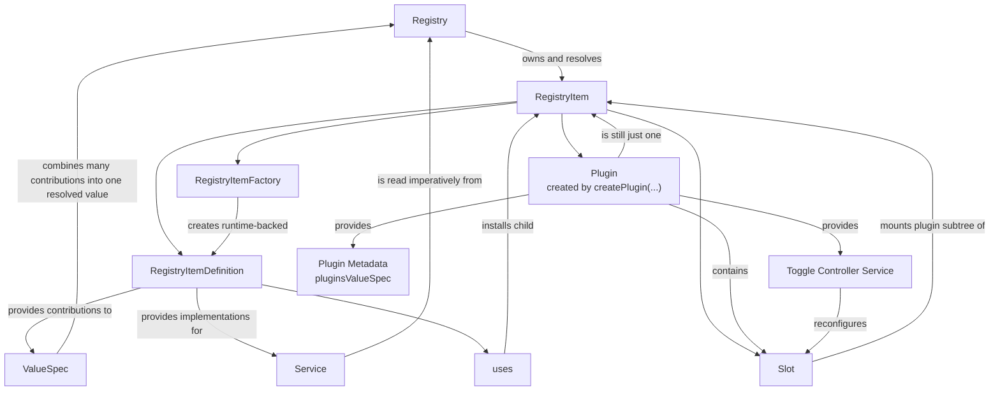

# `@kittycad/registry`

Reactive registry framework for Zoo Design Studio.

This package provides:

- registry value specs for declarative composition
- services for imperative capabilities
- runtime registry items for long-lived state
- slots for runtime reconfiguration
- plugins as the installable developer-facing unit

## Mental Model

- `Registry` owns the active graph and resolves value specs and services.
- `ValueSpec` is a typed registry point that combines many contributions into one value.
- `Service` is a typed capability object that registry items can read from the registry.
- `RegistryItemDefinition` is the declarative unit that contributes value specs, services, and child registry items through `uses`.
- `RegistryItemFactory` creates runtime-backed registry items with stable state.
- `Slot` is a replaceable subtree that can be reconfigured at runtime.
- `createPlugin(...)` packages metadata, a slot, and a toggle controller into one installable registry node.
- `defineContract(...)` marks a shared bundle of `ValueSpec`s and `Service`s that provider and consumer registry items can both depend on without importing each other.

## Concept Map

The most important distinction is:

- a `registry item` is any node in the runtime graph
- a `plugin` is one particular kind of registry node meant to be installed, listed in UI, and toggled at runtime



Read the diagram from top to bottom:

- `Registry` owns a graph of `RegistryItem`s.
- `RegistryItemDefinition`, `RegistryItemFactory`, `Slot`, and `Plugin` are all ways to participate in that graph.
- Plain registry items usually contribute `ValueSpec`s and `Service`s directly.
- A plugin wraps normal registry item content in extra structure: metadata for discovery, a slot for runtime enable/disable, and a toggle controller service.
- So a plugin is not separate from the registry system. It is a higher-level, developer-facing packaging pattern built out of normal registry primitives.

### Slot changes and plugin toggles

`reconfigure(slot, items)` returns a promise and builds and commits a replacement
before returning. If construction or dependency checks fail, it restores the
previous slot contents before reactive observers run and rejects the promise.
Existing runtime instances remain mounted; only instances created by the failed
attempt are cleaned up. Awaiting the promise also waits for cleanup of runtimes
removed by a successful replacement.

Plugin toggles update their `active` signal together with a successful graph
commit. Disabling a plugin required by an active factory rejects and leaves both
the graph and toggle unchanged, including access to the plugin controller.
Cleanup failure after commit rejects the completion promise but leaves the new
graph and activation state in place: already disposed resources cannot be restored.

## Decoupling Pattern

When one registry item defines `ValueSpec`s or `Service`s that another registry
item depends on, avoid exporting the tokens from the provider module itself.

Prefer a small contract module:

- `weather.contract.ts`: exports only shared `ValueSpec`s and `Service`s
- `weather.provider.ts`: imports the contract and provides implementations
- `weather.consumer.ts`: imports the same contract and consumes those tokens

The helper below makes that intent explicit:

```ts
import {
  defineContract,
  defineService,
  firstWinsValueSpec,
} from '@kittycad/registry'

export const weatherContract = defineContract({
  currentTemperatureValueSpec: firstWinsValueSpec<number>(
    'weather.current-temperature',
    0
  ),
  weatherSummaryService: defineService<{ readonly summary: string }>(
    'weather.summary'
  ),
})
```

That pattern decouples the import graph from the registry graph:

- consumers import the contract, not the provider registry item module
- providers and consumers can be configured in either runtime order
- module cycles are less likely as the app grows

For app code, prefer organizing contracts by concern under a dedicated registry
contracts area instead of collecting them into one global file. A good shape is:

- `src/registry/contracts/routes.ts`
- `src/registry/contracts/statusBar.ts`
- `src/registry/contracts/settings.ts`

That keeps contracts close to the registry layer while still avoiding a single
"misc contracts" bucket.

## Factory Dependencies

Factory callbacks return a plain item definition containing contributions, child
items, and optional `dispose` cleanup. No item wrapper or additional helper is
needed; keep model state in the callback and expose it through services.

Use the object form to declare named dependencies. Each entry requires a
`registryItem` to install and a `token` identifying the service or value spec to
consume. The token determines the callback input's type; no input helper or
explicit type annotation is needed.

```ts
export const settingsTomlSerialization = defineRegistryItemFactory({
  id: 'settings-toml',
  dependencies: {
    files: {
      registryItem: fileOperationsExtension,
      token: fileOperationsService,
    },
    settings: {
      registryItem: coreSettingsRegistryItem,
      token: settingsValueSpecExperimental,
    },
  },
  create({ settings }, read) {
    const files = read('files')
    return {
      providesServices: [
        provideService(settingsTomlService, {
          load: () => loadSettings(files, settings.value),
        }),
      ],
    }
  },
})
```

The first `create` argument contains the named dependencies as readonly signals. Service inputs
are required (`ReadonlySignal<T>`); missing services throw instead of returning
`undefined`. Value-spec inputs contain the combined output from **all** active
contributors, not just the named item. Use the ordinary callback form
`defineRegistryItemFactory(ctx => ({ ... }), id)` for optional service observation
or registry reconfiguration. Its `services.signal(token)` and
`services.optional(token)` still permit missing providers.

The registry first expands the known graph, placing dependencies before their
consumers and choosing the first occurrence of each stable ID or object identity.
This planning step does not run callbacks. Dependency cycles raise
`RegistryDependencyError` before known factories run.

Before running a consumer, the registry checks that each winning dependency
subtree contributes its declared token. Contributions in `uses`, slots, and
transitive dependencies count. An unrelated provider cannot mask an incorrect
item/token pair, and a value spec's default does not satisfy the check. Errors
identify the consumer, dependency name, and missing token. Cached consumers are
checked again when the graph changes.

The registry then executes the graph through its ordinary lazy runtime cache. Every
factory follows the same callback and disposal rules, with or without dependencies.
A duplicate factory does not run, and children belonging only to a discarded item
do not run. Items returned by callbacks cannot be known during the initial planning
step; their subtrees are normalized when returned, and already registered identities
win before any of their children execute.

The second `create` argument, `read(name)`, reads a named dependency directly
without evaluating its live signal during construction. Its return type is inferred
from the dependency's token. The current constructor-read policy is **declared
dependencies only**: contributions from every declared dependency subtree, including
transitive prerequisites and returned items, participate. Unrelated roots and override
slots do not contribute unless they are included in those prerequisites. Ordinary
first-identity-wins planning still selects the winning dependency items.

Within this constructor scope, contributions follow dependency traversal order,
with normal precedence, keyed deduplication, service sanitization, conflict checks,
and combine purity rules. This guarantees synchronous provider construction, not
completion of asynchronous provider work. The named item/token contribution checks
above still apply; an unrelated provider or a value spec's default cannot satisfy a
declared dependency.

Live inputs retain their existing registry-wide composition and must be evaluated
after construction. Keeping constructor reads separate avoids caching a partial
constructor result in a signal intended to observe the complete live registry.
Outside graph construction, `read(name)` also reads the complete registry, though
retaining the injected live signals is preferable for reactive consumers.

A factory that reads constructor dependencies captures its dependency scope.
Replacing any item in that scope reconstructs it and its capturing dependents,
then disposes the previous consumers before their previous providers. Unrelated
slot changes preserve these instances. Changes to signal values alone do not rerun
constructors: captured values are snapshots, while injected signals stay live.
Factories using only live inputs retain their instances across provider replacement.
Failed replacements clean up newly created instances in reverse construction order;
the slot transaction restores the previous graph and runtime cache.

Returned `uses` includes child items; it cannot establish prerequisites for the
callback that returned it. Declare those prerequisites in `dependencies` instead.

## Package Layout

- [`src/index.ts`](./src/index.ts): public entrypoint
- [`src/examples/app.ts`](./src/examples/app.ts): tutorial-style example container
- `src/*.test.ts`: unit tests
- `src/*.spec.tsx`: integration/component tests

## Import Policy

This package lives under `packages/`, so relative imports are allowed within the package.
App code outside the package should import it by package name:

```ts
import { Registry, appendValueSpec } from '@kittycad/registry'
```

## Notes

- The example app is documentation, not production app wiring.
- The package currently relies on the repo root toolchain and dependency installation.
