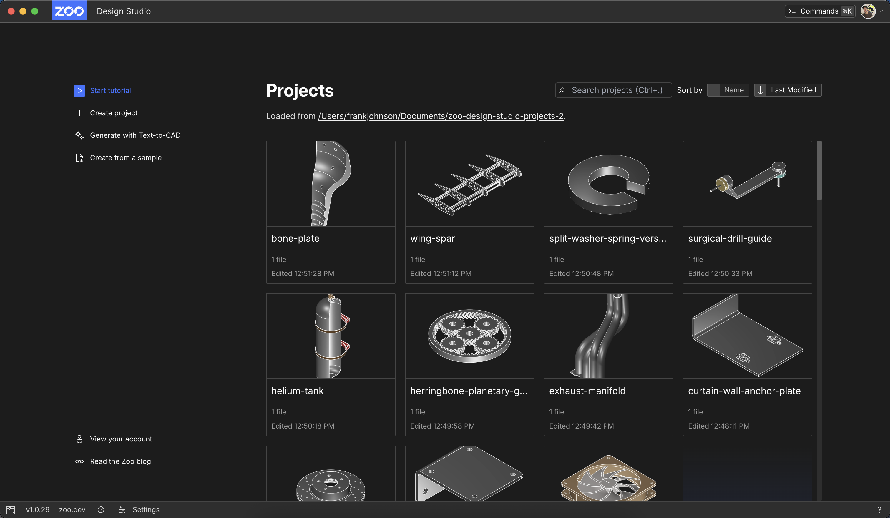
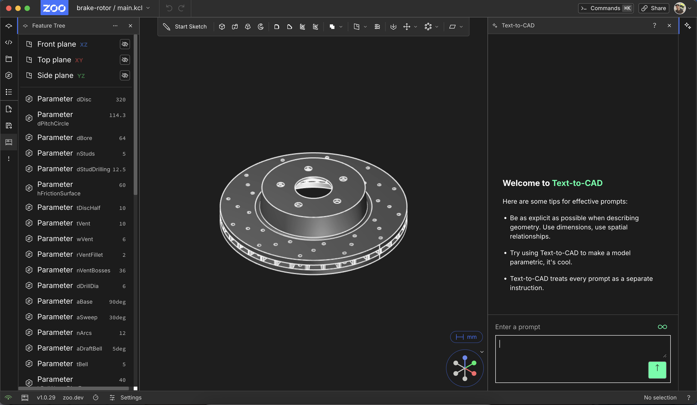
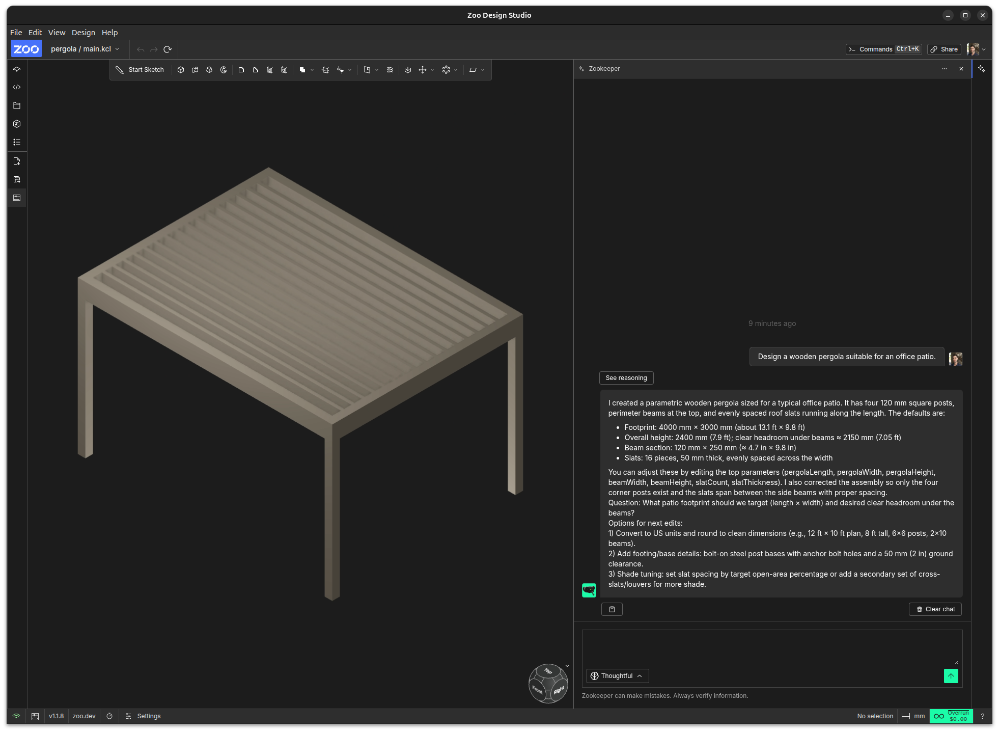

# Glossary

## Design Studio

How we refer to the entire application and all its subsystems. You may often see us refer to "modeling app", "the app", or "ZDS", which are all synonymous.

## Top Bar

The element found at the top (yay descriptive names!) of our interfaces. It is used for navigating around the app, managing your user and project information, and sharing.

## Status Bar

The element found at the bottom of our interfaces. It is used to get information about where you are and what you're doing in the application at the moment.

The left side is for "global" items like your network status, and the right side is for "local", context-specific information such as your current selection in the Workbench.

## Home

The interface within Design Studio where users can choose which project to open, and can create new ones. It consists of a Top Bar, Project Browser, and Status Bar.

## Project Browser

The element found in the middle of the Home interface. It shows projects available to be opened in an area on the right, and a sidebar on the left with action buttons to create blank, generated, or sample projects.

## Workspace

The interface within Design Studio where the user does the real CAD work. It consists of a Top Bar, a Layout, and a Status Bar.

## Workbench

A configuration of the Workspace arranged for one aspect of the CAD ecosystem. Currently the Workspace only has a "modeling" Workbench, but the foundational technologies for drawing and manufacturing Workbenches are under active development by other teams, and will be integrated into ZDS.

**Related:** an [Editor mode](#editor-mode) chooses how one buffer is displayed within the Workbench. Changing editor modes does not select a different Workbench configuration.

## Layout

The arrangement of Areas, Splits, and Panes in the Workbench which house the Design Studio working interfaces.

## Areas

The simplest Layout component. These are the contents of the actual Workbench interface.

## Splits

A kind of Layout that consists of two or more Layouts divided, with a draggable boundary between them. Can be horizontal or vertical.

## Panes

A kind of Split Layout that lets users toggle which Layout elements are active within it. It consists of a pane control bar and a Split Layout of all active panes.

**Related:** the [Editors pane](#editors-pane) is an [Area](#areas) containing editor tabs. Editor tabs select view instances within that Area; the Panes Layout toggles which Layout elements are active.

### Pane control bar

An element which contains a row of buttons that allow users to toggle the activity of Panes. It can be on the top, bottom, left, or right side of a Pane Layout.

**Related:** a tab strip is a related UI control. An editor tab selects a buffer, while a pane control bar toggles Layout elements. The [Tabs component](../packages/ui-components/src/components/Tabs/Tabs.tsx) provides tab-strip interaction.

## Scene

An Area showing the 3D modeling scene. It contains controls to manipulate the CAD assembly and scene via "point & click" interaction. It houses a toolbar of modeling operations to perform, as well as view orientation controls.

### Toolbar

An element within the Scene that contains buttons to invoke modeling operations. It changes based on the current modeling state, such as being in sketch mode.

### View Controls

A cluster of interface elements within the Scene that help the user orient themselves in the 3D space of the Scene.

## Feature Tree

An Area showing the operations used in the CAD assembly. You can think of it as an editable history of modeling operations you've performed.

## Code Editor

An Area housing a code editor for our underlying language for CAD, called [KCL](https://zoo.dev/docs/kcl-book/intro.html). From here you can edit the model directly, and often use features that we are still developing "point & click" workflows for within the Scene.

**Related:** [Editor](#editor) names the live buffer object in the tabbed editor system; [Editor mode](#editor-mode) names a component that displays it. The Code mode supplies that system's CodeMirror interface. These concepts distinguish the buffer and its display from the Code Editor Area. The [Editors pane](#editors-pane) groups these editors into tabs.

## Zookeeper

An Area housing a chat interface with our AI agent. From it you can ask questions about your project, generate CAD models, request edits, and more.

### Prompt

The message or instruction you send to Zookeeper. Prompts can be questions, requests to generate or edit geometry, or anything else you want the agent to do.

### Response

The message Zookeeper sends back after processing a prompt. Responses can include explanations, questions, or actions taken in the project. Zookeeper may suggest next steps as followup edits to the response.

### Tool

A specific capability Zookeeper can use to do something in Design Studio, like creating geometry, editing a feature, or reading project state.

### Cancel

Stops the current Zookeeper operation. Use this when you don't want the current request to finish.

### Reasoning

The internal process Zookeeper uses to decide what to do. This is not always shown directly, but it influences the response and the actions taken.

## Semantic color role

A visual purpose, such as primary text or a secondary surface, whose color is resolved through the active theme. Components select roles through shared utilities such as `text-default`, `bg-2`, and `b-4`. Background, foreground, and border roles have separate scales.

**Also called:** semantic role; visual role, when discussing color.

**Related:** a palette supplies concrete colors; a theme assigns those colors to roles; a semantic utility selects a role in component styling. The [appearance guide](../docs/design-system/appearance.md) explains how to choose and extend roles.

**Search anchors:** [semanticColors.css](semanticColors.css), [tailwind.config.js](../tailwind.config.js).

## Editor

A live text buffer managed by the editors service. An editor has a stable identity, optional source path, working contents, and undo history. Multiple view instances can display it with independent selections. It survives changes to the component displaying it and closes with its project or an explicit close action. Multiple editors can refer to the same file while retaining independent contents.

**Also called:** open editor; editor instance.

**Related:** a file can supply its initial contents; a text buffer holds its working contents; an [Editor mode](#editor-mode) displays it. The [Code Editor](#code-editor) entry describes a UI Area.

**Search anchors:** `Editor`, `EditorsService` in the [editors contract](lib/editors/registry/contract.ts).

## Editor view instance

One presentation of an editor, with its own selected mode, selection, and viewport. Closing the last view closes the backing editor; changing modes retains the view and document.

**Related:** [Editor](#editor) owns the working document; [Editor mode](#editor-mode) supplies its presentation.

## Code editor extension

A contribution of CodeMirror behavior to each matching Code surface, such as syntax highlighting, keybindings, or selection decorations. Its lifetime is separate from the document behavior supplied by an [Editor capability](#editor-capability).

## Editor mode

A contributed component that displays an editor's buffer. An editor can offer several matching modes; each view instance retains its own selected mode. Switching modes preserves the editor's identity, contents, and history. The Code mode supplies the CodeMirror editing interface.

**Also called:** editor view, in the contribution API; contributed surface, in implementation comments. Qualify these names because view also refers to CodeMirror's `EditorView`.

**Related:** [Editor](#editor) supplies the buffer; [Editors pane](#editors-pane) presents the mode chooser; [Code Editor](#code-editor) describes the familiar editing Area; [Workbench](#workbench) describes a broader Workspace configuration.

**Search anchors:** `EditorViewContribution`, `editorViewValueSpec` in the [editors contract](lib/editors/registry/contract.ts).

### Mode context

Data supplied to a mode's component by an optional context provider. The context belongs to a particular view instance and mode. It is created when that mode is first selected, survives mode switches and component remounts, and is released when its view closes, the contribution is removed, or the mode stops matching.

**Related:** the context provider creates the value; the [Editor mode](#editor-mode) receives it; registered cleanup releases resources acquired for it. A provider and its returned context are distinct concepts.

**Search anchors:** `EditorViewHost` in the [editors contract](lib/editors/registry/contract.ts), `defineEditorView(provider)` in [views.ts](lib/editors/views.ts).

## Editor capability

A contribution that acquires document behavior for matching editors. Capabilities provide behavior such as persistence or collaboration independently of how the document is displayed. Applicability can depend on the source path, contents, language classification, or a wildcard.

**Related:** [Editor](#editor) receives the behavior; [Editor language classification](#editor-language-classification) helps determine applicability; [Editor mode](#editor-mode) determines the component displaying the buffer.

**Search anchors:** `EditorCapability`, `editorCapabilityValueSpec` in the [editors contract](lib/editors/registry/contract.ts); `EditorMatcher` and `matchesEditor` in [matching.ts](lib/editors/matching.ts).

## Editor language classification

The language ID and optional media type associated with an editor. Registered language descriptors infer classification from the source and contents. A caller can explicitly choose a registered language, including for an unnamed buffer, or clear that choice to resume inference.

**Also called:** editor classification, in the editor-service documentation.

**Related:** a filename extension can help infer classification; a media type, also called a MIME type, describes the format; an [Editor mode](#editor-mode) is a separate display choice.

**Search anchors:** `EditorClassification`, `EditorsService.setLanguage` in the [editors contract](lib/editors/registry/contract.ts). See [editor-contributions.md](../docs/editor-contributions.md) for matching and explicit language choices.

## Editors pane

The Area that presents open editors as tabs and provides New and Open actions. Each tab represents a view instance. Multiple tabs can display one editor in different modes; independent editors for the same source remain supported.

**Also called:** Editors, in the layout label.

**Related:** [Areas](#areas) identifies its role in the [Layout](#layout); [Editor](#editor) supplies each tab's buffer; [Editor mode](#editor-mode) supplies its displayed component. The [Panes](#panes) entry describes a separate Layout structure.

**Search anchors:** `EditorsPane` in [EditorsPane.tsx](lib/editors/EditorsPane.tsx), `areaType: 'editors'` in [ProjectView.tsx](lib/projectSession/next/ProjectView.tsx). The shared UI controls are `Tabs`, `TabPicker`, and `EmptyState`; tab strip and popover are useful related search terms. See the [ui-components guide](../packages/ui-components/README.md).

### Editor tab indicator

A contributed status component displayed beside an editor's tab label. The component receives the associated editor and determines what information to show. Contributions can specify their display order.

**Related:** [Editors pane](#editors-pane) renders indicators; [Editor](#editor) supplies their context. An indicator reports information independently of the control used to select an [Editor mode](#editor-mode).

**Search anchors:** `EditorTabIndicator`, `editorTabIndicatorValueSpec` in the [editors contract](lib/editors/registry/contract.ts).
