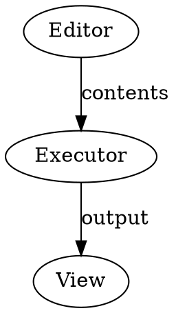

# DOT Graph mode

This project-shell extension contributes DOT highlighting, graph execution through
Graphviz WASM, and a Dragology view for `.dot` and `.gv` files. Registration uses
the existing `zds_project_shell_refactor` feature gate.

Create or open a DOT buffer, then select the **Graph** mode in its tab:

- Drag a node to persist the displayed node positions in the buffer.
- Drag its small upper-right handle to another node to create a connection.
- Drag an edge endpoint to reconnect an unambiguous standalone edge.
- Use **Add node** to insert a node, the wheel to zoom, and middle-drag to pan.
- Use ordinary editor undo/redo and saving for graph changes.

Persisted `pos="x,y!"` attributes use Graphviz points (72 per inch), with
`inputscale=72` and `notranslate=true`. The view flips the vertical axis for SVG.
Authored positions remain authoritative; Graphviz supplies missing positions.
Fully positioned graphs use `nop2` to avoid re-layout and recentering.

This is a basic node-and-edge editing view, rather than Graphviz's full styled
SVG output. Edge chains, grouped endpoints, and ambiguous parallel edges render,
but reconnecting those edges requires editing the source. Source edits preserve
comments and unrelated attributes; a source change during a gesture cancels its
writeback. Parsing currently supports one graph per file.
